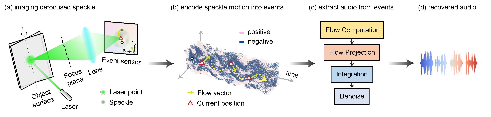

# EventizedAudio

**From changes in light to reconstructed sound.** Recover an audio signal from event-camera recordings of a vibrating surface. Run the offline optical-flow pipeline on CPU, or use the online method with the separate Metavision SDK.

Bring a structured event recording **and its matching reference audio**. This is a research reproduction workflow, with alignment and speech-quality evaluation built into both methods. It does not record from a camera or microphone, and it is not a reference-free audio extractor.

[Research data](https://berkeley.box.com/s/4kdfmdx84xhot3145qkhnh1s2qg5w55e) · [Verification and limits](docs/verification.md)

## From events to audio

Event cameras report pixel-level brightness changes as a stream of events. The reconstruction uses this stream to measure fast motion in laser speckle patterns and reconstruct audio. Two paths are included: offline dense optical flow, and online time-gradient optical flow.



*Optical vibration sensing pipeline.*

## Choose a path

| Path | What you need | Start here |
| --- | --- | --- |
| Offline reconstruction | Python 3.12, CPU, events and matching reference audio | Setup and single-recording command below |
| Online reconstruction | The same inputs plus Metavision SDK | Install the SDK, then use `online` |
| Synthetic compatibility check | Python dependencies; no dataset or camera | [Run the generated fixture](#try-without-research-data) |

## Set up

Use Python 3.12 in a virtual environment. The offline pipeline runs on CPU; a CUDA GPU is not required.

```bash
git clone https://github.com/nazeeh111/EventizedAudio.git
cd EventizedAudio
python3.12 -m venv .venv
source .venv/bin/activate
python -m pip install -r requirements.txt
```

For **online** processing, also install [Metavision SDK for Python](https://docs.prophesee.ai/4.6.2/index.html) in a supported environment. It provides `metavision_sdk_cv`; it is not included in the pip requirements. Offline processing does not need that SDK.

Download recordings and matching ground-truth audio from the [research dataset](https://berkeley.box.com/s/4kdfmdx84xhot3145qkhnh1s2qg5w55e). Recordings must be NumPy structured arrays containing `x`, `y`, `t` (microseconds), and `p` (0/1 polarity). Both algorithms require matching ground-truth audio for alignment and evaluation.

## Reconstruct a recording

Create a fresh destination directory before processing. Here the event file is `abespeech_chipbag.npy` and the corresponding reference is `abespeech_gt.wav`:

```bash
mkdir -p Output
python eventized_audio.py offline \
  --event_path EventRecordings/abespeech_chipbag.npy \
  --gt_path GroundTruth/abespeech_gt.wav \
  --out_path Output/abespeech_chipbag_hat_offline.wav
```

Use `online` in place of `offline` for the SDK-based method. For a folder:

```bash
python eventized_audio.py batch \
  --event_dir EventRecordings --gt_dir GroundTruth \
  --out_dir Output --mode offline
```

The existing `run_offline.py`, `run_online.py`, and `launch_runs.py` commands still work. `python eventized_audio.py --help` shows the new entry point; `python eventized_audio.py offline --help` shows the offline options once dependencies are installed.

### Find the results

The requested `--out_path` is a naming prefix. A successful new reconstruction writes these files:

For the command above, `PREFIX` means `Output/abespeech_chipbag_hat_offline`:

- **44.1 kHz reconstruction:** `PREFIX_44khz.wav`.
- **16 kHz reconstruction:** `PREFIX_pesq<SCORE>_stoi<SCORE>.wav`, named with its evaluation scores.
- **Converted reference:** `abespeech_gt_16khz.wav`, written **beside the input reference** in `GroundTruth/`.

PESQ and STOI compare the reconstruction with the reference audio. A filename containing scores is not an independent validation of the research method. Use a writable working copy of the reference directory. Direct `offline`/`online` commands can replace its derived `_16khz.wav`; `batch` instead reuses an identical valid regular cache or refuses a conflicting one. See [batch preservation and recovery](docs/batch-preservation.md). The unsuffixed requested output is normally not created.

### Recover from a failed run

- **Missing reference:** batch pairs the portion before the first underscore with `<identifier>_gt.wav` or `<identifier>_gt.mp3`. Keep one matching reference per identifier.
- **Missing SDK:** use `offline` if `metavision_sdk_cv` is unavailable. It is required only for `online`.
- **Interrupted or incomplete output:** `batch` refuses an occupied incomplete set with exit 2; retry into a **new `--out_dir`**. A lone `_44khz.wav` is not completion. A conflicting reference cache also requires a fresh working copy of the reference directory. See [the exact skip/refusal and partial-publication policy](docs/batch-preservation.md).
- **Existing unsuffixed output:** choose a new `--out_path`. If that exact file already exists, the inherited single-recording script evaluates it instead of reconstructing again.

## Try without research data

After setup, run the reproducible synthetic compatibility check:

```bash
python tests/verify_offline_equivalence.py
```

It generates 250,000 events and a reference signal locally, runs the retained baseline and the current offline entry point, and compares the WAV bytes. Inspect `.verification/results.json` for the sample counts and hashes. This checks software compatibility on one generated input. It is **not recovered speech, an event-camera recording, or evidence of listening quality**. No redistributable research audio sample is bundled.

## Verification and limits

See [the verification record](docs/verification.md) for behavioral comparisons, the preserved processing interfaces, and environment limitations. Defaults, numerical processing and successful WAV bytes/names are preserved for the verified synthetic control. Batch output admission, cache reuse and failure publication follow the separate [preservation policy](docs/batch-preservation.md).

Batch processing validates input folders and unique matching ground-truth names, supports paths containing spaces, skips intact output pairs, and stops with the child process exit code if reconstruction fails. A child failure publishes no staged products for that recording; publication errors can retain new partial products, as described in the policy. Empty, degenerate, or malformed event arrays are not validated by the reconstruction algorithms.

Maintained by [nazeeh111](https://github.com/nazeeh111).

## Source and license

[NOTICE.md](NOTICE.md) records the retained implementation’s origins and EventizedAudio’s additions.

Original implementation: [MIT license](LICENSE). New additions: [LICENSE-branding](LICENSE-branding). External component and dataset limits are recorded in the source notice.
